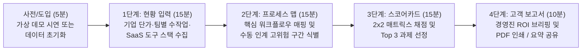

# Auto AX — 서비스 기획서 (`PLAN.md`)

> **문서 버전**: 1.0  
> **프로젝트명**: Auto AX — AI 자동화 진단 키트 (AI Automation Audit Kit)  
> **배포 URL**: https://songyoungsim.github.io/Auto-AX-consulting/  
> **작성일**: 2026-11-28  

---

## 1. 기획 배경 및 목적

### 1.1 문제 정의 (Pain Points)
1. **정성적·파편화된 현장 인터뷰**: 컨설턴트가 고객사(중견·중소기업)를 방문해 업무 자동화 컨설팅을 진행할 때, 부서별 반복 수작업과 시스템 간 수동 인계(Manual Handoff) 병목이 엑셀·메모장에 파편화되어 기록됩니다.
2. **ROI 산출 및 보고서 작성 지연**: 인터뷰 이후 수작업 비용 환산, 우선순위 평가, 경영진 설득용 ROI 보고서 및 30·60·90일 로드맵을 작성하는 데 수일 이상의 후속 작업이 소요됩니다.
3. **도입 의사결정 병목**: 경영진은 추상적인 AI 도입 제안보다 **"현재 수작업으로 연간 얼마를 잃고 있는지"**와 **"어떤 과제부터 투자해야 몇 개월 안에 회수(Payback)되는지"**를 즉각적으로 확인하기를 원합니다.

### 1.2 기획 목적 (Vision & Goal)
- **현장 즉시 진단 및 실시간 시각화**: 고객사 인터뷰 현장에서 입력과 동시에 연간 수작업 손실 인건비, 수동 인계 위험 구간, 우선순위 매트릭스를 실시간으로 시각화합니다.
- **ROI 기반 의사결정 자동화**: 영향도(Impact) 대비 투입 난이도(Effort) 분석을 통해 **핵심 Top 3 자동화 과제**를 도출하고, 1년차 순 ROI 및 투자 회수 기간을 즉시 산출합니다.
- **Zero-Delay 경영진 리포트 산출**: 미팅 종료 시점에 PDF 인쇄 및 텍스트 공유가 가능한 **경영진 요약 보고서와 30·60·90일 실행 로드맵**을 원클릭으로 생성합니다.

---

## 2. 타겟 사용자 및 활용 시나리오

### 2.1 핵심 타겟 (Persona)
| 구분 | 타겟 그룹 | 주요 니즈 및 활용 목적 |
| --- | --- | --- |
| **Primary** | **AX / DX 비즈니스 컨설턴트** | 고객사 인터뷰 현장에서 빠른 데이터 수집, 객관적인 우선순위 도출, 즉각적인 제안서/보고서 산출 |
| **Secondary** | **기업 내 혁신/기획·운영 리드 (TF)** | 사내 부서별 반복 업무 조사, SaaS 구독 비용 및 API 연동성 점검, 경영진 보고용 자동화 투자 근거 마련 |
| **Stakeholder** | **고객사 경영진 (CEO / CFO / COO)** | 투자 대비 재무적 효과(연간 절감액, 1년차 순 ROI, 회수 기간)와 단계별(30·60·90일) 실행 계획 확인 |

### 2.2 컨설팅 미팅 활용 플로우

---

## 3. 서비스 핵심 가치 및 차별점

1. **현장 친화적 4단계 워크플로우**: `현황 입력` → `프로세스 맵` → `스코어카드` → `고객 보고서`의 선형 구조로 설계되어 인터뷰 흐름을 자연스럽게 리드합니다.
2. **수동 인계(Manual Handoff) 병목 특화 진단**: 단순 작업 시간뿐만 아니라 시스템/부서 간 복사·붙여넣기, 이메일 전달 등 오류가 집중되는 수동 인계 구간과 위험도(`낮음`/`보통`/`높음`)를 시각적으로 플래깅합니다.
3. **실시간 재무·ROI 시뮬레이션**: 평균 시간당 인건비(원화 `원` / 달러 `$` 자동 판별)를 기반으로 연간 수작업 인건비, Top 3 도입 시 연간 절감액, 1년차 순편익, 순 ROI(%), 회수 기간(개월/일)을 실시간 계산합니다.
4. **Zero-Backend & 완벽한 데이터 프라이버시**: 별도 서버로 고객사 민감 데이터를 전송하지 않고 브라우저 `localStorage`(`auto_ax_state_v1`)에만 자동 저장되어 보안 우려 없이 현장에서 즉시 사용할 수 있습니다.
5. **즉시 시연 가능한 프리셋 탑재**: B2B 산업자재 유통·제조 기업(`에이펙스 산업유통(주)`) 시나리오가 기본 내장되어 있어 별도 준비 없이도 완벽한 제품 시연이 가능합니다.

---

## 4. 정보 구조도 (IA) 및 화면 구성

### 4.1 전체 화면 레이아웃 구조
- **상단 글로벌 헤더 (`.app-header`)**: 브랜드 로고, 현재 진단 대상 고객사 배지, 4단계 탭 내비게이션, `사용 가이드` 모달 버튼, `데모 데이터 초기화` 버튼
- **플랫폼 히어로 & 실시간 텔레메트리 (`.platform-hero`)**:
  - `Client Target` (기업명 및 임직원 규모)
  - `Sector` (업종 및 진단 기준일)
  - `Weekly Manual Load` (총 주간 수작업 시간 및 평균 시급)
  - `Lead & Handoffs` (담당 컨설턴트, 수동 인계 건수, Top 3 선정 수)
- **메인 워크스페이스 (`#main-content`)**: 선택된 탭에 따라 4개 핵심 모듈 뷰 렌더링

### 4.2 4대 핵심 기능 모듈 상세 기획

#### [탭 1] `1. 현황 입력` (`#intake`)
- **목적**: 고객사 기본 프로필, 부서별 수작업 부하, 사용 중인 SaaS 도구 및 API 연동성을 정량 수집합니다.
- **주요 기능**:
  - **3단계 입력 마법사**:
    1. `01. 기업 프로필`: 기업명, 업종(드롭다운+직접입력), 전체 임직원 수, 평균 시간당 인건비, 진단 일자, 담당 컨설턴트
    2. `02. 팀별 수작업`: 팀 추가/삭제, 팀명, 소속 인원, 주간 수작업 시간(`0.5`시간 단위), 주요 사용 도구(쉼표 구분 태그), 주요 수작업 병목 및 고충 메모
    3. `03. 도구 스택`: 도구 추가/삭제, 도구명, 카테고리(CRM, ERP, 고객지원 등), 월간 구독료, REST API / Webhook 지원 여부 토글
  - **포커스 보존 실시간 진단 요약 사이드바**: 타이핑 중 커서 끊김 없이 우측 요약 카드에 `총 주간 수작업 시간`, `연간 수작업 인건비 추정`, `월간/연간 SaaS 지출`, `API 연동 가능 도구 비율`을 실시간 반영합니다.

#### [탭 2] `2. 프로세스 맵` (`#process-map`)
- **목적**: 엔드투엔드(End-to-End) 업무 흐름을 단계별로 분해하고, 부서/시스템 간 수동 인계 병목을 시각화합니다.
- **주요 기능**:
  - **상단 프로세스 KPI 스트립**: 전체 단계 수, 수동 인계 단계 수, 고위험(`high`) 인계 건수, 주간 총 소요 시간 및 주간/연간 수동 인계 소모 시간 표시
  - **단계 필터링**: `전체 단계` 보기 / `수동 인계만` 모아보기 토글
  - **수평 프로세스 카드 & SVG 커넥터**:
    - 각 단계의 순서(`#01`~), 단계명, 담당 팀, 사용 도구, 회당 소요 시간(분) × 주간 실행 횟수 = **주간 소요 시간(h)** 자동 계산
    - 단계 간 연결 화살표를 상태에 따라 **초록 실선(`다음`)**, **노랑 점선(`수동 인계`)**, **빨강 점선(`고위험`)**으로 자동 구분
    - 카드 내 인라인 `수동 인계` 체크박스 및 `위험도`(`낮음`/`보통`/`높음`) 즉시 변경 지원
  - **단계 추가/수정 모달**: 순서, 단계명, 담당 팀(자동완성), 사용 도구(자동완성), 소요 시간/빈도, 수동 인계 경로(`From` → `To`), 진단 메모 편집

#### [탭 3] `3. 스코어카드` (`#scorecard`)
- **목적**: 발굴된 자동화 후보 과제를 영향도(Impact)와 난이도(Effort) 기준으로 평가하고 최우선 착수할 **Top 3 과제**를 선정합니다.
- **주요 기능**:
  - **2×2 Impact vs. Effort 매트릭스 (Interactive SVG)**:
    - 기준선(`5.5`)을 중심으로 4개 사분면 시각화:
      - **빠른 성과 (Quick Wins)**: `영향도 ≥ 5.5`, `난이도 < 5.5` (틸 `#01B2A9`)
      - **전략적 과제 (Strategic)**: `영향도 ≥ 5.5`, `난이도 ≥ 5.5` (네이비 `#002C5C`)
      - **보완 과제 (Fill-ins)**: `영향도 < 5.5`, `난이도 < 5.5` (그레이 `#768B99`)
      - **후순위 (Deprioritize)**: `영향도 < 5.5`, `난이도 ≥ 5.5` (레드 `#D94848`)
    - 매트릭스 노드 호버/클릭 시 하단 상세 카드 및 우측 우선순위 테이블 양방향 하이라이트 연동
  - **우선순위 채점 테이블**:
    - `영향도`(1~10) 및 `난이도`(1~10) 슬라이더 드래그 시 **우선순위 점수(`영향도 ÷ 난이도`)** 실시간 프리뷰 및 드롭 시 자동 재정렬
    - 주간 절감 시간, 초기 구축비, 연간 절감액, 투자 회수 기간(`즉시` / `N일` / `N.N개월`), 추진 단계(`30일`/`60일`/`90일`) 표시
  - **Top 3 선정 컨트롤**:
    - 수동 별표(`☆`/`★`) 토글로 최대 3개 과제 선정 (초과 클릭 시 안내 배너 표시)
    - **`★ Top 3 자동 선정`**: 우선순위 점수 상위 3개 과제를 원클릭 자동 선택
    - **`+ 자동화 과제 추가`**: 신규 자동화 아이디어, 연계 프로세스 단계, 필요 도구, 예상 절감 시간 및 구축비 등록

#### [탭 4] `4. 고객 보고서` (`#report`)
- **목적**: 경영진 보고 및 내부 품의에 즉시 활용할 수 있는 최종 진단 리포트와 30·60·90일 실행 로드맵을 생성합니다.
- **주요 기능**:
  - **보고서 헤더 & 경영진 요약(Executive Summary)**: 고객사 메타데이터 표지와 함께 진단 데이터를 기반으로 자동 조합된 경영진 요약 내러티브 제공
  - **5대 핵심 ROI KPI 카드**:
    1. `연간 절감 시간` (Top 3 기준 연간 확보 시간 및 주간 절감 시간)
    2. `연간 비용 절감액` (시간당 인건비 기준 연간 인건비 절감액 및 전체 수작업 대비 절감률)
    3. `구축 투자 비용` (Top 3 초기 구축비 합계 및 1년차 순편익)
    4. `1년차 순 ROI` (`(연간 절감액 - 구축비) ÷ 구축비 × 100`)
    5. `투자 회수 기간` (월 환산 절감액 대비 손익분기 도달 개월 수)
  - **`01` Top 3 추천 자동화 과제**: 선정된 3대 과제의 우선순위 점수, 추진 단계, 주간 절감 시간, 연간 절감액, 구축비, 필요 도구 및 **연계된 프로세스 병목 단계 기반 추천 근거(Rationale)** 자동 생성
  - **`02` 수동 핸드오프 위험 요약**: 고위험/중위험 수동 인계 단계 리스트 및 인계 경로(`From → To`), 연간 소모 시간 요약
  - **`03` 30-60-90일 실행 로드맵**:
    - **1~30일 (Quick Wins · 즉시 효과 창출)**: API 즉시 연동 및 파일럿 검증 과제
    - **31~60일 (핵심 워크플로우 확장)**: 부서 간 통합 및 OCR/문서 자동화 과제
    - **61~90일 (거버넌스 & 지능형 고도화)**: 경영진 대시보드, 모니터링 및 전사 확산 과제
  - **출력 및 공유 액션**:
    - **`요약 복사`**: 이메일·메신저 공유용 플레인 텍스트 리포트 클립보드 복사
    - **`PDF로 인쇄`**: `@media print` 인쇄 전용 레이아웃(내비게이션 숨김, 페이지 분할 방지, 배경색 보존)을 통한 PDF 즉시 출력

---

## 5. 핵심 비즈니스 로직 및 산출 공식

| 지표명 | 산출 공식 및 기준 | 활용 화면 |
| --- | --- | --- |
| **총 주간 수작업 시간** | $\sum (\text{팀별 주간 수작업 시간})$ *(0일 경우 프로세스 단계별 주간 시간 합계 폴백)* | 현황 입력, 히어로, 고객 보고서 |
| **연간 수작업 인건비 추정** | $\text{총 주간 수작업 시간} \times 52\text{주} \times \text{평균 시간당 인건비}$ | 현황 입력 |
| **단계별 주간 소요 시간** | $(\text{회당 소요 시간(분)} \times \text{주간 실행 횟수}) \div 60$ | 프로세스 맵, 고객 보고서 |
| **우선순위 점수 (Priority Score)** | $\text{영향도 점수 (1~10)} \div \text{투입 난이도 점수 (1~10)}$ | 스코어카드, 고객 보고서 |
| **Top 3 연간 비용 절감액** | $\sum_{a \in \text{Top3}} (\text{주간 절감 시간}_a) \times 52\text{주} \times \text{평균 시간당 인건비}$ | 스코어카드, 고객 보고서 |
| **1년차 순편익 (Net Year-1 Benefit)** | $\text{Top 3 연간 비용 절감액} - \sum_{a \in \text{Top3}} (\text{초기 구축 비용}_a)$ | 고객 보고서 |
| **1년차 순 ROI (%)** | $(\text{1년차 순편익} \div \text{Top 3 총 구축 비용}) \times 100$ | 고객 보고서 |
| **투자 회수 기간 (Payback Period)** | $\text{구축 비용} \div (\text{연간 비용 절감액} \div 12\text{개월})$ *(1개월 미만 시 일 단위 환산)* | 스코어카드, 고객 보고서 |
| **통화 자동 포맷팅** | `hourlyRate >= 1000` 시 원화(`원`), 미만 시 달러(`$`) 자동 표기 | 스코어카드, 고객 보고서 |

---

## 6. UI/UX 및 디자인 시스템 기획

### 6.1 디자인 컨셉: META BIOMED 정밀 메드테크 디자인 시스템
컨설팅 보고서의 신뢰감과 정밀한 진단 도구의 성격을 동시에 전달하기 위해 클리니컬 캔버스와 딥 네이비, 고채도 틸(Teal) 액센트를 조합한 디자인 시스템을 적용합니다.

- **Primary Accent**: `#01B2A9` (Precision Teal) / Hover `#009B93`
- **Authority & Header**: `#111722` (Deep Navy) / `#002C5C` (Strategic Blue)
- **Canvas & Surface**: `#F5F8F8` (Clinical Paper) / `#FFFFFF` (Pure Surface) / `#C3DAD9` (Border Line)
- **Semantic Status**:
  - 긍정/자동화 완료: `#009B93`
  - 주의/수동 인계(보통): `#C98A12`
  - 위험/고위험 병목: `#D94848`
  - 프리미엄/Top 3 강조: `#FFD171` (Gold)
- **타이포그래피**: 영문/숫자 디스플레이 `Montserrat`, 국문 본문 `Noto Sans KR`, 보조 영문 `Open Sans`

### 6.2 핵심 UX 원칙
1. **무중단 타이핑 (Focus-Safe Reactive UI)**: 현장에서 빠르게 메모할 때 상태 업데이트로 인해 입력창 포커스가 풀리지 않도록 부분 DOM 업데이트(`updateSummaryDOM`)와 편집 중 전체 재렌더링 방지(`isEditingInsideMain`)를 적용합니다.
2. **인쇄 친화적 레이아웃 (Print-First Report)**: 별도 PDF 생성 서버 없이도 브라우저 인쇄(`Ctrl+P` / `PDF로 인쇄`)만으로 전문 컨설팅 펌 수준의 A4 보고서가 출력되도록 `@media print` 스타일을 정교하게 제어합니다.

---

## 7. 기본 시연 시나리오 (`에이펙스 산업유통(주)`)

초기 접속 또는 `데모 데이터 초기화` 클릭 시 로드되는 레퍼런스 시나리오입니다.

- **고객사 프로필**: `에이펙스 산업유통(주)` (B2B 산업자재 유통·제조, 임직원 48명, 평균 시급 `$65`, 담당: 김서연 수석 컨설턴트)
- **현황 요약**: 4개 핵심 부서(영업·견적, 수주 운영, 재무·정산, 고객지원)에서 **주간 총 140시간**(연간 **$473,200** 상당)의 반복 수작업 발생, 6개 SaaS 도구(월 $6,400, API 지원 5개) 사용 중
- **프로세스 병목**: 7개 주요 업무 단계 중 **5개 수동 인계 구간**(고위험 4건)에서 주간 **59.5시간**(연간 3,094시간) 소모
- **Top 3 추천 과제 및 기대 효과**:
  1. `AI RFQ 파서 및 자동 견적 초안 생성` (30일 단계, 주 24시간 절감, 구축비 $8,500)
  2. `HubSpot-NetSuite 수주 자동 동기화` (30일 단계, 주 20시간 절감, 구축비 $11,000)
  3. `AI OCR 기반 3자 정산 자동 대사` (60일 단계, 주 11시간 절감, 구축비 $7,500)
- **최종 ROI 성과**: 주당 **55시간**(전체 수작업의 39%) 절감, 연간 **$185,900** 절감, 총 구축비 **$27,000**, **1년차 순 ROI 589%**, 투자 회수 기간 **약 1.7개월**

---

## 8. 향후 고도화 로드맵 (Future Enhancements)

| 단계 | 주요 고도화 항목 | 기대 효과 |
| --- | --- | --- |
| **v1.1 (단기)** | **다중 고객사 프로젝트 파일 내보내기/가져오기 (`.json` Export/Import)** | 컨설턴트가 여러 고객사 진단 세션을 로컬 파일로 백업·교체하며 재사용 가능 |
| **v1.2 (중기)** | **업종별 진단 템플릿 프리셋 (제조·유통, 이커머스, 금융/회계, 헬스케어)** | 고객사 업종 선택 시 해당 업종의 대표 수작업 단계와 자동화 후보 과제를 원클릭 추천 |
| **v2.0 (장기)** | **LLM 연동 자동 과제 추천 및 아키텍처 다이어그램 생성** | 입력된 팀별 고충(Pain Points)과 도구 스택을 분석해 맞춤형 자동화 워크플로우(Make/n8n/Zapier/LLM API)를 자동 설계 |

---

## 9. 관련 문서 링크

- [README (`README.md`)](./README.md) — 프로젝트 요약 및 로컬 실행 안내
- [사용자 매뉴얼 (`USER_MANUAL.md`)](./USER_MANUAL.md) — 컨설턴트용 탭별 상세 사용법 및 실무 팁
- [기술 명세서 (`TECH_SPEC.md`)](./TECH_SPEC.md) — 상태 관리, 데이터 모델(ERD), 모듈 인터페이스 및 ROI 수식 명세
- [배포 가이드 (`DEPLOY.md`)](./DEPLOY.md) — GitHub Pages, Cloudflare Pages, Vercel, Netlify 배포 방법
