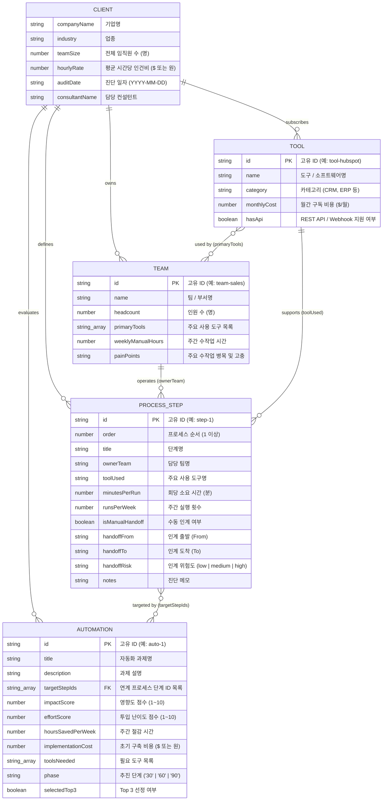

# Auto AX — AI 자동화 진단 키트 기술 명세서 (`TECH_SPEC.md`)

> **문서 버전**: 1.0  
> **대상 워크스페이스**: `c:\projects\test`  
> **기준 코드베이스**: `index.html`, `src/app.js`, `src/state.js`, `src/styles.css`, `src/modules/*.js`

---

## 1. 프로젝트 개요 및 기술 스택

**Auto AX**는 컨설턴트가 고객사의 반복 수작업과 시스템 간 수동 인계(Handoff) 병목을 정량화하고, 투자수익률(ROI) 기반의 자동화 우선순위 및 30·60·90일 실행 로드맵을 설계·보고할 수 있도록 구축된 **웹 기반 AI 자동화 진단 키트**입니다.

### 핵심 기술 스택

| 구분 | 기술 및 사양 | 설명 |
| --- | --- | --- |
| **런타임 / 모듈** | Vanilla JavaScript (ES Modules) | `<script type="module" src="./src/app.js">` 기반의 순수 브라우저 네이티브 모듈 구조 |
| **빌드 방식** | Zero-build (No Bundler / No Transpiler) | Webpack, Vite, Babel 등 빌드 파이프라인 없이 정적 HTTP 서버만으로 즉시 실행 |
| **상태 영속성** | Web Storage API (`window.localStorage`) | `STORAGE_KEY = 'auto_ax_state_v1'` 키로 클라이언트 브라우저에 진단 데이터 자동 저장 |
| **디자인 시스템** | META BIOMED 정밀 메드테크 디자인 시스템 | `src/styles.css` 전역 CSS 변수 토큰 + 각 모듈별 Scoped `<style>` 동적 주입 |
| **시각화 / 출력** | Inline SVG + CSS `@media print` | 2×2 영향도-난이도 매트릭스 및 워크플로우 커넥터를 순수 SVG로 렌더링, PDF 인쇄 최적화 |

### 디자인 토큰 요약 (`src/styles.css`)

- **브랜드 / 강조색**: `--accent: #01B2A9`, `--accent-dark: #009B93`, `--accent-soft: #E3EDEC`, `--gold: #FFD171`
- **배경 / 표면 / 경계선**: `--bg-paper: #F5F8F8`, `--bg-surface: #FFFFFF`, `--line: #C3DAD9`, `--line-strong: #A3C4C3`
- **텍스트 / 네이비**: `--navy: #111722`, `--navy-2: #161E2C`, `--deep-blue: #002C5C`, `--ink: #262E33`, `--ink-muted: #768B99`
- **상태 색상**: `--positive: #009B93`, `--danger: #D94848`, `--warning: #C98A12`
- **타이포그래피**: `--font-sans` (`Noto Sans KR`, `Open Sans`), `--font-display` (`Montserrat`, `Noto Sans KR`)

---

## 2. 디렉터리 및 파일 아키텍처

```text
c:\projects\test\
├── index.html                  # 애플리케이션 진입점 (폰트/전역 CSS 로드, #app 마운트)
├── TECH_SPEC.md                # 본 기술 명세서
└── src/
    ├── app.js                  # 앱 셸, 해시 라우팅, 헤더 텔레메트리, 모듈 오케스트레이션
    ├── state.js                # 중앙 상태 저장소, localStorage 영속화, DEFAULT_STATE
    ├── styles.css              # 전역 디자인 토큰 및 공통 셸/버튼/카드 스타일
    └── modules/
        ├── intake.js           # [탭 1] 3단계 현황 입력 마법사 & 실시간 진단 요약 사이드바
        ├── process-map.js      # [탭 2] 수평 프로세스 맵 & 수동 인계(Handoff) 위험 진단
        ├── scorecard.js        # [탭 3] 2×2 SVG 매트릭스 & 우선순위 스코어카드 / Top 3 선정
        └── report.js           # [탭 4] 경영진 진단 보고서, 30-60-90일 로드맵 & PDF 인쇄
```

### 파일별 역할 및 소유 범위

| 파일 경로 | 주요 심볼 / 소유 기능 | 스타일 격리 ID |
| --- | --- | --- |
| `index.html` | Google Fonts(`Montserrat`, `Noto Sans KR`, `Open Sans`) 로드, `<div id="app"></div>` 제공 | — |
| `src/styles.css` | `:root` 디자인 토큰, `.app-shell`, `.app-header`, `.platform-hero`, `.app-main` 레이아웃 | 전역 스타일시트 |
| `src/state.js` | `DEFAULT_STATE`, `STORAGE_KEY`, `getState`, `setState`, `subscribe`, `resetState` | — |
| `src/app.js` | `TABS`, `buildShell`, `updateHeaderMeta`, `navigateTo`, `renderActiveTab`, `isEditingInsideMain`, `actions` | — |
| `src/modules/intake.js` | `renderIntake`, `computeSummary`, `updateSummaryDOM`, `renderStep1`~`3` | `ax-intake-styles` |
| `src/modules/process-map.js` | `renderProcessMap`, `calcWeeklyHours`, `renderStepCard`, `renderConnector`, `renderModal` | `auto-ax-process-map-styles` |
| `src/modules/scorecard.js` | `renderScorecard`, `getPriorityScore`, `getQuadrantInfo`, `getPaybackText`, `sortAutomations` | `auto-ax-scorecard-styles` |
| `src/modules/report.js` | `renderReport`, `computeReportMetrics`, `buildExecutiveNarrative`, `buildPlainTextSummary`, `buildRationale` | `auto-ax-report-styles` |

---

## 3. 상태 관리 아키텍처 (`src/state.js`)

Auto AX는 외부 라이브러리 없이 단방향 데이터 흐름과 발행-구독(Pub/Sub) 패턴을 결합한 경량 중앙 상태 저장소를 사용합니다.

### 핵심 상수 및 API

- **`STORAGE_KEY = 'auto_ax_state_v1'`**: `window.localStorage`에 상태를 직렬화하여 저장하는 키.
- **`loadInitialState()`**: 앱 초기화 시 `localStorage`에서 JSON을 읽어 `DEFAULT_STATE`와 안전하게 병합합니다.
  - `client`: `{ ...clone(DEFAULT_STATE.client), ...(parsed.client || {}) }` (누락 필드 보완)
  - `teams`, `tools`, `processSteps`, `automations`: `Array.isArray(...)` 검증 실패 시 `clone(DEFAULT_STATE.*)`로 폴백
  - JSON 파싱 실패 또는 `localStorage` 접근 불가 시 `clone(DEFAULT_STATE)` 반환
- **`getState()`**: 현재 메모리상의 `currentState` 객체 반환.
- **`setState(updater)`**:
  1. `updater`가 함수이면 `updater(clone(currentState))` 실행(불변성 유지를 위해 `JSON.parse(JSON.stringify(value))` 깊은 복사본 전달), 객체이면 `{ ...currentState, ...(updater || {}) }` 병합.
  2. `currentState` 갱신 후 `persistState(currentState)` 호출 (`localStorage.setItem` 실패 시 용량 초과/프라이버시 모드 예외를 조용히 무시).
  3. 등록된 모든 `listeners` (`Set`) 콜백을 순회 실행.
- **`subscribe(fn)`**: 상태 변경 구독 등록 후 구독 해제 함수(`() => listeners.delete(fn)`) 반환.
- **`resetState()`**: `currentState`를 `clone(DEFAULT_STATE)`로 복원하고 `persistState` 및 모든 구독자 통지 실행.

### 상태 동기화 및 포커스 보호 흐름 (`src/app.js`)

```text
사용자 입력 / 버튼 클릭
  └─▶ actions.setState(updater)
        ├─▶ localStorage 저장 (persistState)
        └─▶ subscribe 콜백 실행 ─▶ renderActiveTab(false)
              ├─▶ updateHeaderMeta(state) (상단 고객명 & 히어로 텔레메트리 즉시 갱신)
              └─▶ isEditingInsideMain() 검사
                    ├─ true  (INPUT/TEXTAREA/SELECT/contentEditable 포커스 중) ─▶ 전체 DOM 재렌더링 생략 (포커스 보존)
                    └─ false ─▶ main.innerHTML = '' 후 activeTab.render(main, state, actions) 실행
```

> **참고**: `intake.js`는 입력 중 사이드바 수치만 갱신하기 위해 `isInternalStateUpdate` 플래그와 `updateSummaryDOM()`을 추가로 사용하며, `process-map.js` 및 `scorecard.js`는 모달/호버/선택 상태를 모듈 스코프 `uiState` 객체에 보관하여 재렌더링 시 UI 상태가 유지되도록 설계되어 있습니다.

---

## 4. 데이터 모델 및 ERD 다이어그램

### Mermaid `erDiagram`



### 5개 엔티티 상세 필드 명세표

#### 1) `CLIENT` (`state.client` — 단일 객체)

| 필드명 | 타입 | 기본/제약 | 설명 |
| --- | --- | --- | --- |
| `companyName` | `string` | 필수 권장 | 진단 대상 고객사명 |
| `industry` | `string` | 선택 옵션 또는 커스텀 문자열 | 고객사 업종 (`intake.js`의 `INDUSTRY_OPTIONS` 참조) |
| `teamSize` | `number` | `>= 1` 정수 | 전체 임직원 수 (명) |
| `hourlyRate` | `number` | `>= 0` (`report.js`에서 `>= 1000` 시 원화 처리) | 평균 시간당 인건비. 연간 수작업 비용 및 ROI 계산 기준 |
| `auditDate` | `string` | `YYYY-MM-DD` | 진단 수행 일자 |
| `consultantName` | `string` | 문자열 | 진단 담당 컨설턴트 이름/직책 |

#### 2) `TEAM` (`state.teams[]` — 배열)

| 필드명 | 타입 | 기본/제약 | 설명 |
| --- | --- | --- | --- |
| `id` | `string` | PK (`team_*` 또는 `team-*`) | 팀 식별자 |
| `name` | `string` | 문자열 | 팀 또는 부서명 |
| `headcount` | `number` | `>= 0` 정수 | 부서 소속 인원 수 (명) |
| `primaryTools` | `string[]` | 쉼표 구분 입력 파싱 | 부서에서 주로 사용하는 소프트웨어 목록 |
| `weeklyManualHours` | `number` | `>= 0`, `0.5` 단위 | 부서의 주간 반복 수작업 총 시간 |
| `painPoints` | `string` | 문자열 | 반복 복사·붙여넣기, 대사, 승인 지연 등 병목 서술 |

#### 3) `TOOL` (`state.tools[]` — 배열)

| 필드명 | 타입 | 기본/제약 | 설명 |
| --- | --- | --- | --- |
| `id` | `string` | PK (`tool_*` 또는 `tool-*`) | 도구 식별자 |
| `name` | `string` | 문자열 | 사용 중인 SaaS 또는 레거시 시스템명 |
| `category` | `string` | `TOOL_CATEGORIES` 참조 | CRM, ERP, 커뮤니케이션, 스프레드시트 등 분류 |
| `monthlyCost` | `number` | `>= 0` | 월간 구독/유지 비용 |
| `hasApi` | `boolean` | `true` / `false` | 자동화 연동을 위한 REST API / Webhook 지원 여부 |

#### 4) `PROCESS_STEP` (`state.processSteps[]` — 배열)

| 필드명 | 타입 | 기본/제약 | 설명 |
| --- | --- | --- | --- |
| `id` | `string` | PK (`step-*`) | 프로세스 단계 식별자 |
| `order` | `number` | `>= 1` 정수 | 워크플로우 내 표시 순서 (오름차순 정렬 기준) |
| `title` | `string` | 필수 (`제목 없는 단계` 폴백) | 업무 단계명 |
| `ownerTeam` | `string` | 문자열 | 담당 팀명 (`TEAM.name`과 논리적 연계) |
| `toolUsed` | `string` | 문자열 | 해당 단계의 주요 사용 도구 (`TOOL.name`과 논리적 연계) |
| `minutesPerRun` | `number` | `>= 0` | 1회 실행당 소요 시간 (분) |
| `runsPerWeek` | `number` | `>= 0` | 주간 실행 빈도 (회/주) |
| `isManualHandoff` | `boolean` | `true` / `false` | 수동 인계(복사/붙여넣기, 이메일 전달, 수동 업로드) 여부 |
| `handoffFrom` | `string` | 문자열 | 수동 인계 출발 주체/시스템 |
| `handoffTo` | `string` | 문자열 | 수동 인계 도착 주체/팀 |
| `handoffRisk` | `'low' \| 'medium' \| 'high'` | 기본 `'medium'` | 수동 인계로 인한 오류/지연 위험도 |
| `notes` | `string` | 문자열 | 병목 원인 및 자동화 기회 메모 |

#### 5) `AUTOMATION` (`state.automations[]` — 배열)

| 필드명 | 타입 | 기본/제약 | 설명 |
| --- | --- | --- | --- |
| `id` | `string` | PK (`auto-*`) | 자동화 후보 과제 식별자 |
| `title` | `string` | 필수 | 자동화 과제명 |
| `description` | `string` | 문자열 | 자동화 대상 업무 흐름 및 기대 효과 설명 |
| `targetStepIds` | `string[]` | `PROCESS_STEP.id` 참조 배열 | 연계된 프로세스 단계 ID 목록 (`report.js` 근거 생성에 사용) |
| `impactScore` | `number` | `1 ~ 10` 정수 (`clampScore`) | 비즈니스 영향도 점수 |
| `effortScore` | `number` | `1 ~ 10` 정수 (`clampScore`) | 구현 투입 난이도 점수 |
| `hoursSavedPerWeek` | `number` | `>= 0`, `0.5` 단위 | 도입 시 주간 절감 예상 시간 |
| `implementationCost` | `number` | `>= 0` | 일회성 초기 구축 비용 |
| `toolsNeeded` | `string[]` | 문자열 배열 | 구현에 필요한 도구/API 스택 |
| `phase` | `'30' \| '60' \| '90'` | 기본 `'30'` | 30·60·90일 로드맵 추진 단계 |
| `selectedTop3` | `boolean` | 최대 3개 선정 | 핵심 추천 Top 3 과제 포함 여부 |

---

## 5. 모듈 인터페이스 계약

### 탭 라우팅 계약 (`src/app.js`)

`src/app.js`는 `TABS` 배열을 통해 4개 기능 모듈을 등록하며, URL 해시(`#intake`, `#process-map`, `#scorecard`, `#report`)와 동기화합니다.

```js
const TABS = [
  { id: 'intake', label: '1. 현황 입력', render: renderIntake },
  { id: 'process-map', label: '2. 프로세스 맵', render: renderProcessMap },
  { id: 'scorecard', label: '3. 스코어카드', render: renderScorecard },
  { id: 'report', label: '4. 고객 보고서', render: renderReport },
];
```

### 렌더러 시그니처 및 `actions` 객체

모든 모듈은 동일한 진입점 인터페이스를 구현합니다.

```ts
renderModule(container: HTMLElement, state: AppState, actions: Actions): void
```

| 전달 인자 | 타입 / 구성 | 설명 |
| --- | --- | --- |
| `container` | `HTMLElement` (`#main-content`) | 모듈 마크업이 마운트되는 루트 컨테이너 |
| `state` | `AppState` | `getState()`로 조회한 최신 전체 상태 스냅샷 |
| `actions` | `{ getState, setState, resetState, navigateTo }` | 상태 조회/변경/초기화 및 탭 이동 컨트롤러 |

#### `actions` 메서드 계약

- **`getState()`**: 최신 상태 객체 반환.
- **`setState(updater)`**: 상태 업데이트 및 `localStorage` 영속화, 구독자 통지 트리거.
- **`resetState()`**: `DEFAULT_STATE`로 초기화 (헤더의 `데모 데이터 초기화` 버튼에서 `window.confirm` 후 호출).
- **`navigateTo(tabId)`**: 유효한 `TABS` ID(`'intake' | 'process-map' | 'scorecard' | 'report'`)로 `activeTabId` 변경, `history.replaceState`로 URL 해시 갱신, 즉시 강제 렌더링(`renderActiveTab(true)`) 및 스크롤 최상단 이동.

#### 모듈별 구현 특이사항

1. **`renderIntake(container, state, actions)`** (`src/modules/intake.js`):
   - 내부 스텝 상태(`currentStep: 1 | 2 | 3`)를 유지하며, 이미 마운트된 상태에서 내부 입력(`isInternalStateUpdate` 또는 `activeInside`)이 발생하면 전체 DOM을 교체하지 않고 `updateSummaryDOM(existingRoot, state)`만 수행해 입력 포커스를 유지합니다.
2. **`renderProcessMap(container, state, actions)`** (`src/modules/process-map.js`):
   - 모듈 스코프 `uiState` (`filter: 'all' | 'manual'`, `modalMode: null | 'add' | 'edit'`, `editingId`)를 유지합니다.
3. **`renderScorecard(container, state, actions)`** (`src/modules/scorecard.js`):
   - 모듈 스코프 `uiState` (`selectedId`, `hoveredId`, `showAddForm`, `notice`)를 유지하며, 슬라이더(`input` 이벤트) 드래그 중에는 점수 프리뷰만 갱신하고 `change` 이벤트에서 `actions.setState()`를 커밋합니다.
4. **`renderReport(container, state, actions)`** (`src/modules/report.js`):
   - 읽기 전용 보고서 뷰를 렌더링하며, `요약 복사` (`navigator.clipboard.writeText` + `execCommand('copy')` 폴백) 및 `PDF로 인쇄` (`window.print()`) 액션을 제공합니다.

---

## 6. 핵심 비즈니스 로직 및 ROI 계산 공식

아래 수식은 각 모듈의 소스 코드에 실제로 구현된 계산 로직만 정확히 기술한 것입니다.

### 6.1 현황 입력 요약 (`src/modules/intake.js` — `computeSummary`)

- **총 주간 수작업 시간**:
  $$\text{totalWeeklyManualHours} = \sum_{t \in \text{teams}} \max(0, \text{t.weeklyManualHours})$$
- **연간 수작업 인건비 추정**:
  $$\text{estimatedAnnualLaborCost} = \text{totalWeeklyManualHours} \times 52 \times \max(0, \text{client.hourlyRate})$$
- **총 SaaS 도구 지출**:
  $$\text{totalMonthlyToolSpend} = \sum_{tool \in \text{tools}} \max(0, \text{tool.monthlyCost}), \quad \text{totalAnnualToolSpend} = \text{totalMonthlyToolSpend} \times 12$$
- **API 지원 도구 수**: `tools.filter(t => Boolean(t.hasApi)).length`

### 6.2 프로세스 맵 시간 계측 (`src/modules/process-map.js` — `calcWeeklyHours`)

- **단계별 주간 소요 시간**:
  $$\text{calcWeeklyHours}(\text{step}) = \frac{\text{minutesPerRun} \times \text{runsPerWeek}}{60}$$
- **전체 워크플로우 주간 시간**: 모든 단계의 `calcWeeklyHours(step)` 합계
- **주간 수동 인계 시간**: `isManualHandoff === true`인 단계들의 `calcWeeklyHours(step)` 합계
- **연간 수동 인계 소모 시간**: `Math.round(totalHandoffHours * 52)`

### 6.3 스코어카드 우선순위 및 2×2 매트릭스 (`src/modules/scorecard.js`)

- **점수 보정 (`clampScore`)**: `impactScore`, `effortScore`를 `1` 이상 `10` 이하의 정수로 반올림 보정 (유효하지 않은 값은 기본 `5`).
- **우선순위 점수 (`getPriorityScore`)**:
  $$\text{PriorityScore} = \frac{\text{clampScore}(\text{impactScore})}{\text{clampScore}(\text{effortScore})}$$
- **정렬 기준 (`sortAutomations`)**:
  1. `PriorityScore` 내림차순 (`|diff| > 0.0001`)
  2. 동점 시 `impactScore` 내림차순
  3. 동점 시 `hoursSavedPerWeek` 내림차순
- **2×2 사분면 분류 (`getQuadrantInfo`)**: 중심 기준선 `5.5` 적용
  - `impact >= 5.5` & `effort < 5.5` → **빠른 성과** (`#01B2A9`)
  - `impact >= 5.5` & `effort >= 5.5` → **전략적 과제** (`#002C5C`)
  - `impact < 5.5` & `effort < 5.5` → **보완 과제** (`#768B99`)
  - `impact < 5.5` & `effort >= 5.5` → **후순위** (`#D94848`)
- **과제별 연간 절감액**:
  $$\text{annualSavings} = \text{hoursSavedPerWeek} \times 52 \times \text{hourlyRate}$$
  *(참고: `scorecard.js`에서는 `client.hourlyRate`가 유효하지 않을 때 기본값 `75` 사용)*
- **투자 회수 기간 (`getPaybackText`)**:
  - `implementationCost <= 0` → `'즉시'`
  - `monthlySavings = annualSavings / 12 <= 0` → `'해당 없음'`
  - `months = implementationCost / monthlySavings`: `1`개월 미만이면 `${Math.max(1, Math.round(months * 30))}일`, `1`개월 이상이면 `${months.toFixed(1)}개월`

### 6.4 경영진 보고서 ROI 지표 (`src/modules/report.js` — `computeReportMetrics`)

- **기준 시급 및 통화 판별**:
  - `hourlyRate = Number(client.hourlyRate) || 65`
  - `isKrw = hourlyRate >= 1000` (`true`이면 원화 `원` 표기, `false`이면 USD `$` 표기)
- **진단된 주간 수작업 시간 (`totalManualHoursPerWeek`)**:
  - 팀별 주간 수작업 합계(`teamManualHours`)가 `0`보다 크면 `teamManualHours` 사용, 그렇지 않으면 프로세스 단계별 주간 시간 합계(`stepManualHours`)를 폴백으로 사용.
- **Top 3 대상 선정**:
  - `selectedTop3 === true`인 항목을 우선순위 점수순으로 최대 3개 선택.
  - 선정된 항목이 없으면 전체 과제를 우선순위 점수순 정렬 후 상위 3개를 자동 선택(`usedFallbackTop3 = true`).
- **Top 3 통합 ROI 공식**:
  $$\text{top3HoursSavedPerWeek} = \sum_{a \in \text{top3}} \text{a.hoursSavedPerWeek}$$
  $$\text{annualSavings} = \text{top3HoursSavedPerWeek} \times 52 \times \text{hourlyRate}$$
  $$\text{implementationCost} = \sum_{a \in \text{top3}} \text{a.implementationCost}$$
  $$\text{netYear1Benefit} = \text{annualSavings} - \text{implementationCost}$$
  $$\text{netYear1RoiPct} = \begin{cases} \dfrac{\text{netYear1Benefit}}{\text{implementationCost}} \times 100 & (\text{implementationCost} > 0) \\ 100 & (\text{implementationCost} \le 0 \land \text{annualSavings} > 0) \\ 0 & (\text{otherwise}) \end{cases}$$
  $$\text{paybackMonths} = \begin{cases} \dfrac{\text{implementationCost}}{\text{annualSavings} / 12} & (\text{annualSavings} > 0) \\ 0 & (\text{annualSavings} \le 0) \end{cases}$$
- **전체 수작업 대비 절감 비율**: `Math.min(100, Math.round((top3HoursSavedPerWeek / totalManualHoursPerWeek) * 100))`

---

## 7. 기본 가상 데모 데이터(`DEFAULT_STATE`) 요약 및 로컬 실행/검증 방법

### 7.1 `DEFAULT_STATE` 요약 (`에이펙스 산업유통(주)`)

초기 실행 시 `src/state.js`에 내장된 B2B 산업자재 유통·제조 기업 시나리오가 자동 로드됩니다.

- **고객사 프로필 (`client`)**: `에이펙스 산업유통(주)` | `B2B 산업자재 유통·제조` | 임직원 `48명` | 시간당 인건비 `$65` | 진단일 `2026-11-18` | `김서연 수석 컨설턴트`
- **진단 팀 (`teams`, 4개 팀 / 30명 / 총 주간 140시간)**:
  - `영업 및 견적팀` (10명, 주 38시간)
  - `수주 운영팀` (8명, 주 44시간)
  - `재무·정산팀` (5명, 주 26시간)
  - `고객지원팀` (7명, 주 32시간)
- **도구 스택 (`tools`, 6개 도구 / 월 총 $6,400 / API 지원 5개)**:
  - `HubSpot CRM` ($1,200, API O), `NetSuite ERP` ($3,400, API O), `Zendesk` ($850, API O), `Excel / Google Sheets` ($320, API O), `Slack` ($450, API O), `레거시 물류 포털` ($180, API X)
- **프로세스 단계 (`processSteps`, 7단계)**:
  - 수동 인계(`isManualHandoff: true`) 5건 포함 (고위험 `high` 4건: `step-1`, `step-3`, `step-4`, `step-6`, 보통 `medium` 1건: `step-5`)
- **자동화 후보 (`automations`, 6건)**:
  - **Top 3 선정 과제**:
    1. `AI RFQ 파서 및 자동 견적 초안 생성` (`auto-1`, Phase `30`, 영향도 9 / 난이도 4, 주 24시간 절감, 구축비 $8,500)
    2. `HubSpot-NetSuite 수주 자동 동기화` (`auto-2`, Phase `30`, 영향도 10 / 난이도 5, 주 20시간 절감, 구축비 $11,000)
    3. `AI OCR 기반 3자 정산 자동 대사` (`auto-3`, Phase `60`, 영향도 8 / 난이도 4, 주 11시간 절감, 구축비 $7,500)
  - **Top 3 기준 예상 성과**: 주당 `55시간` 절감 (연 2,860시간), 연간 절감액 `$185,900`, 구축 투자비 `$27,000`, 1년차 순 ROI `589%`, 투자 회수 기간 `약 1.7개월`

### 7.2 로컬 실행 및 검증 방법

#### 실행 방법
본 프로젝트는 `<script type="module">`을 사용하므로 브라우저의 `file://` 프로토콜에서는 CORS 정책으로 ES 모듈 로드가 차단됩니다. 반드시 로컬 HTTP 서버를 통해 실행하세요.

```powershell
# 방법 1: Python 내장 HTTP 서버 (c:\projects\test 에서 실행)
python -m http.server 8080

# 방법 2: Node.js serve 패키지
npx serve . -p 8080
```

실행 후 브라우저에서 `http://localhost:8080` 으로 접속합니다.

#### 기능 검증 체크리스트

1. **현황 입력 (`#intake`)**: `01. 기업 프로필` → `02. 팀별 수작업` → `03. 도구 스택` 스텝 전환 및 입력 시 우측 `실시간 진단 요약` 사이드바와 상단 히어로 텔레메트리가 즉시 갱신되는지 확인.
2. **프로세스 맵 (`#process-map`)**: `전체 단계` / `수동 인계만` 필터 전환, 카드 내 `수동 인계` 토글 및 `위험도` 변경, `+ 단계 추가` 모달 저장 후 SVG 커넥터와 KPI 스트립 반영 확인.
3. **스코어카드 (`#scorecard`)**: 슬라이더 드래그 시 우선순위 점수 실시간 프리뷰 및 2×2 SVG 매트릭스 점 위치 이동 확인, `★ Top 3 자동 선정` 및 최대 3개 제한 알림 동작 확인.
4. **고객 보고서 (`#report`)**: Top 3 선정 변경 사항이 ROI 지표(`연간 비용 절감액`, `1년차 순 ROI`, `회수 기간`) 및 `30-60-90일 실행 로드맵`에 반영되는지 확인, `요약 복사` 및 `PDF로 인쇄` 미리보기 동작 확인.
5. **영속성 및 초기화**: 브라우저 새로고침 후 `localStorage`(`auto_ax_state_v1`) 상태 유지 여부 및 헤더 `데모 데이터 초기화` 버튼으로 `DEFAULT_STATE` 복원 여부 확인.
